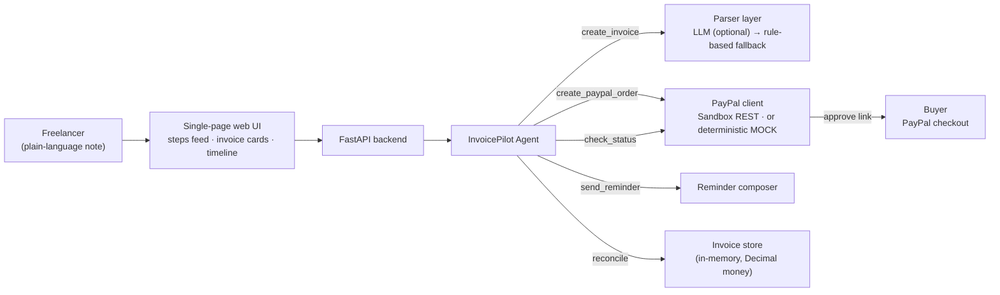

# 🧾 InvoicePilot — the agent that gets you paid

**An autonomous AI agent for freelancers and small sellers that runs the whole get-paid loop**: describe your work in plain language, and InvoicePilot drafts the invoice, creates a real PayPal payment link, watches for payment, politely chases late payers, and reconciles the books — no spreadsheets, no awkward follow-up emails, no forgotten invoices.

Built for the **PayPal AI Hackathon** (*Build What's Next with PayPal and AI*), targeting **Best Use of Agentic Commerce**: this is an agent you can walk away from — it does the commerce work unattended, end to end.

---

## The problem

Freelancers lose money twice: once on the work, and again on the admin. Studies of freelance work routinely find that a large share of invoices are paid late — and many are simply forgotten by the person who sent them. Writing the invoice, generating a payment link, checking whether it was paid, and sending the *"just checking in…"* email is exactly the kind of multi-step, tool-spanning busywork an agent should own.

## What InvoicePilot does

1. **You say the job out loud.** *"Logo design for Maria's bakery, $450, due Friday."*
2. **The agent understands it** — LLM tool-use when a key is configured, a deterministic rule-based parser otherwise — and drafts a structured invoice (client, amount, tax, due date) with exact Decimal money math.
3. **The agent creates a PayPal order** (Sandbox Orders v2 API) and sends the buyer a payment link.
4. **The agent monitors payment status.** When the buyer approves, the agent *captures* the payment itself — approval alone never counts as paid — and marks the invoice PAID only when PayPal reports the capture COMPLETED.
5. **If the due date passes, the agent sends a polite, context-aware reminder** with the payment link — firm on facts, friendly in tone.
6. **The agent reconciles**: invoiced vs collected vs outstanding vs overdue, always current.

## Architecture



| Layer | Tech |
|---|---|
| Agent core | Python, explicit tool functions (`create_invoice`, `create_paypal_order`, `check_status`, `send_reminder`, `reconcile`) |
| Understanding | LLM tool-use behind an interface + deterministic rule-based fallback parser (dates, amounts, tax, "due Friday" → real date) |
| Payments | PayPal Sandbox REST — OAuth2 client credentials (auto-refreshing token) + Orders v2 (create / capture / get), itemised tax breakdown |
| Web | FastAPI + one self-contained HTML/CSS/JS page (no build step) |
| Money | `Decimal` everywhere, ROUND_HALF_UP to cents — totals are exact and unit-tested |
| Tests | pytest — 62 tests: parser + edge cases, money math, payment state machine, API hardening, LLM-output validation, full agent flow over HTTP in mock mode |

### Built to be trusted with money

- **Real payment lifecycle** — CREATED → APPROVED → *captured* → COMPLETED, mirrored exactly by the mock, so demo behaviour is sandbox behaviour.
- **Idempotent creates** — send an `Idempotency-Key` header and a retried/double-clicked request returns the original invoice instead of minting a duplicate (or a second PayPal order).
- **Validated at every boundary** — API payloads (no negative amounts, no >100% tax), natural-language input (no $0 invoices, no impossible dates), and LLM output (untrusted JSON is field-checked before it can become an invoice; anything off falls back to the deterministic parser).
- **Safe rendering** — user-supplied text is HTML-escaped before it appears on the checkout page.
- **Failure-tolerant** — a flaky PayPal status call degrades to a reported agent step, never a crashed loop.

## Quickstart

```bash
git clone https://github.com/prasad-anandappa/invoicepilot.git
cd invoicepilot
python3 -m venv .venv
.venv/bin/pip install -r requirements.txt
.venv/bin/uvicorn app.main:app --port 8000
```

Open **http://localhost:8000** — it runs immediately in **MOCK mode**: the PayPal layer is simulated deterministically (including a clickable mock checkout page), so the whole loop works with zero credentials and zero real money.

### Switch to the real PayPal Sandbox

Create a REST app at [developer.paypal.com](https://developer.paypal.com/dashboard/applications/sandbox), then:

```bash
export PAYPAL_CLIENT_ID="your-sandbox-client-id"
export PAYPAL_CLIENT_SECRET="your-sandbox-secret"
export PAYPAL_MODE=sandbox
```

Restart — the same agent now creates real sandbox orders and returns genuine PayPal approve links. **No code changes.**

### Optional: LLM parsing

```bash
export INVOICEPILOT_LLM_API_KEY="..."   # any OpenAI-compatible endpoint
```

With a key, the LLM extracts invoice fields; on any failure the agent silently falls back to the built-in parser. The demo never depends on it.

## Demo walkthrough (2 minutes)

1. **Create** — type *"Logo design for Maria's bakery, $450, due Friday"* and watch the Agent activity feed: parse → invoice INV-1001 → PayPal order → status check.
2. **Pay** — click **Pay with PayPal** on the invoice card; the (simulated) PayPal checkout opens; click *Pay now*; you're returned with a green "Payment confirmed" banner and the invoice flips to **PAID**.
3. **Chase** — create *"Birthday cake order for Priya, $85, due yesterday"*: it lands as **OVERDUE**; click **Send reminder** and read the agent's polite nudge, link included.
4. **Reconcile** — the panel shows $535 invoiced, $450 collected, $85 outstanding/overdue. Click **Reconcile now** for the agent's spoken summary.

## API

Both create endpoints accept an optional `Idempotency-Key` header — retrying with the same key returns the original invoice instead of creating a duplicate.

| Endpoint | What it does |
|---|---|
| `POST /api/invoices/from-text` | Full agent loop from one plain-language note |
| `POST /api/invoices` | Structured invoice creation + PayPal order |
| `GET /api/invoices` · `GET /api/invoices/{id}` | List / fetch invoices |
| `POST /api/invoices/{id}/check-status` | Poll PayPal, mark PAID |
| `POST /api/invoices/{id}/remind` | Compose + record a reminder |
| `POST /api/invoices/{id}/simulate-pay` | Mock-mode buyer payment (demo) |
| `GET /api/reconcile` | Totals + per-invoice breakdown |
| `GET /api/health` | Mode report (mock vs sandbox, parser in use) |

## Tests

```bash
.venv/bin/python -m pytest -q   # 62 tests, all offline in mock mode
```

## AI tools used

- LLM tool-use interface for natural-language invoice extraction (OpenAI-compatible chat API, optional at runtime)
- Deterministic rule-based NLP parser (regex + calendar logic) as the always-available fallback
- PayPal Sandbox REST APIs (Orders v2, OAuth2)
- FastAPI, Pydantic, httpx, pytest
- Built with AI-assisted development (Muse)

## Roadmap

Real email/SMS reminder delivery · PayPal Invoicing API + webhooks (instant PAID detection instead of polling) · recurring invoices · multi-currency · persistent database · a "collections tone" setting (gentle → firm escalation ladder).

## Author

**Prasad Dimba Anandappa** — GitHub [@prasad-anandappa](https://github.com/prasad-anandappa)

## License

MIT — see [LICENSE](LICENSE).
